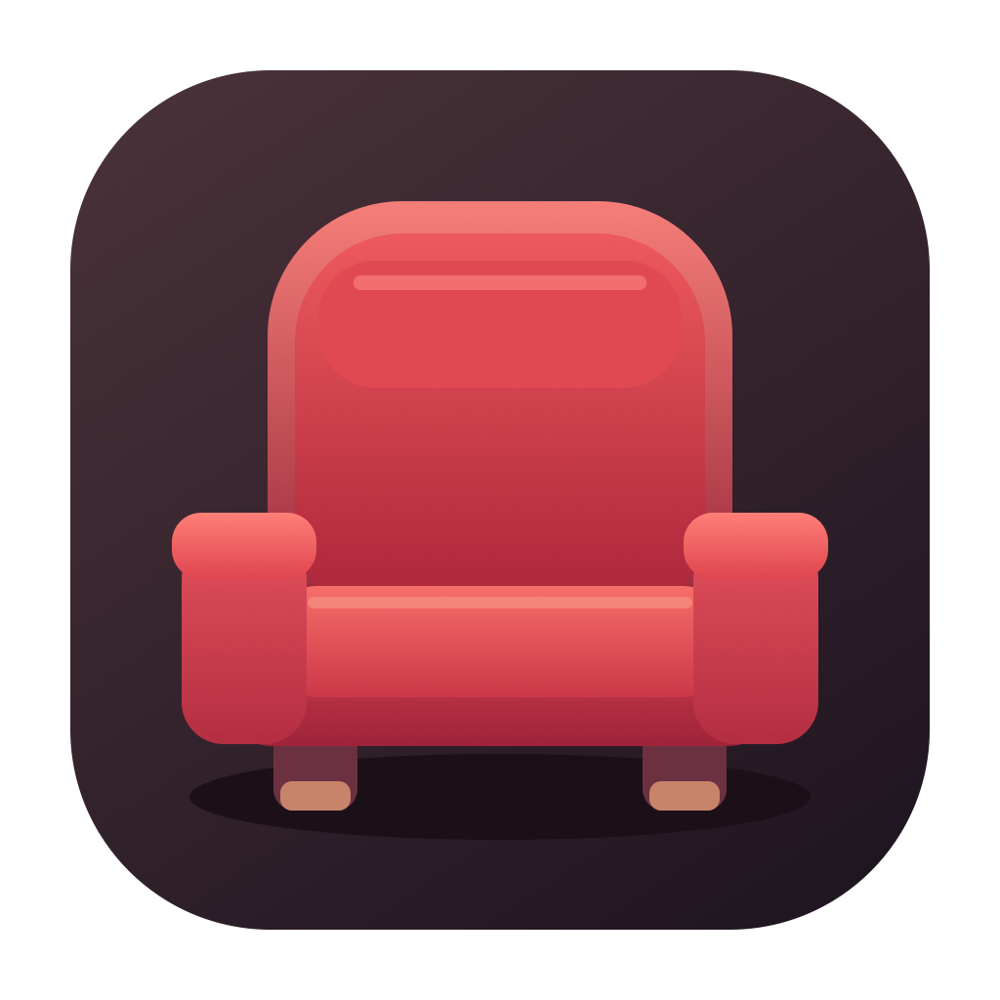

# Fauteuil

**Ta médiathèque personnelle sur Mac, prête pour le hors ligne.** Retrouve tes vidéos locales et tes playlists YouTube dans une interface pensée pour regarder, reprendre et enchaîner tes vidéos.

[Download for macOS](https://github.com/NicoPFr/Fauteuil/releases/latest) · [English](docs/README.en.md) · [Configurer Google](app/CONFIGURER_GOOGLE.md) · [Kit de présentation](docs/press/README.md)

## Ce que tu peux faire

- Ajouter des vidéos locales sans les dupliquer et organiser les séries par saison et épisode.
- Retrouver tes abonnements et playlists YouTube avec ton compte Google, ou ajouter une playlist par son lien. Les résultats écartent les Shorts et, par précaution, les vidéos de trois minutes ou moins.
- Lire dans l’app, reprendre à la dernière position et enchaîner les épisodes à ton rythme.
- Commencer à regarder pendant le téléchargement quand le format le permet. Fauteuil prépare automatiquement une copie temporaire si la lecture progressive échoue.
- Garder certains titres hors ligne, individuellement ou par sélection. Les copies temporaires se nettoient après visionnage. Tes fichiers personnels restent à leur emplacement.

## Installation

1. Télécharge l’archive universelle dans les [releases GitHub](https://github.com/NicoPFr/Fauteuil/releases/latest), décompresse-la et ouvre **Fauteuil.app**. La compilation cible macOS 13 ou ultérieur, pour Apple Silicon et Intel. La release utilise une signature ad hoc et n’est pas notariée. Si macOS bloque son ouverture, la compilation locale est l’autre option.
2. Installe les dépendances avec [Homebrew](https://brew.sh/) via `brew install python ffmpeg yt-dlp deno`. Pour résoudre les changements côté YouTube, garde [yt-dlp et son moteur JavaScript](https://github.com/yt-dlp/yt-dlp#dependencies) à jour.
3. Dans **Mes vidéos**, utilise **Ajouter des vidéos**, ou range tes fichiers dans `~/Movies/Youtube/Movies`. La lecture des fichiers locaux fonctionne sans compte.
4. Pour les abonnements et les playlists personnelles, suis le [guide Google](app/CONFIGURER_GOOGLE.md). Chaque installation utilise son propre client OAuth.

YouTube peut limiter la disponibilité de certains contenus et formats. Télécharge uniquement les vidéos que tu es autorisé à enregistrer.

## Compiler et tester

Avec les outils en ligne de commande Xcode, Python 3.11 ou ultérieur et les dépendances ci-dessus, lance `make build` et ouvre `build/Fauteuil.app`. Utilise `make universal` pour compiler les deux architectures et `make test` avec Node.js pour les tests locaux. `python3 scripts/demo.py` sert l’interface avec une bibliothèque fictive sur le port 8767.

Fauteuil utilise Swift, AppKit et WebKit pour la fenêtre et le lecteur, puis Python et SQLite pour le catalogue local. Les préférences et métadonnées restent sur le Mac. Les jetons durables sont stockés dans le trousseau. Projet indépendant, sous [licence MIT](LICENSE).
