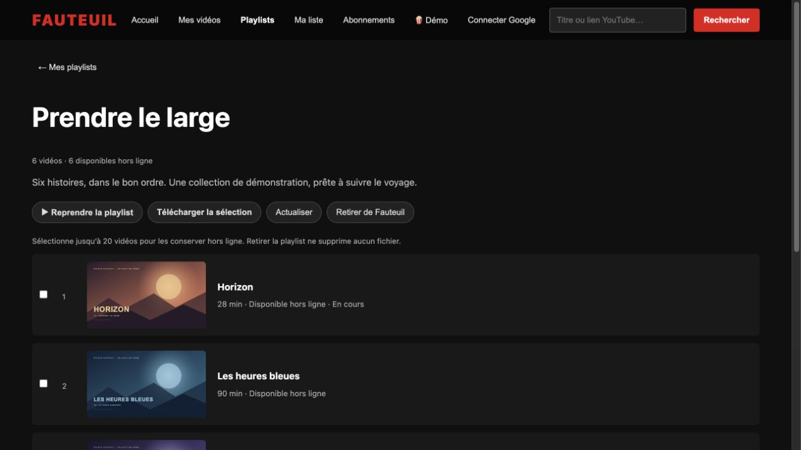

# Fauteuil

**Ta médiathèque personnelle sur Mac, prête pour le hors ligne.** Retrouve tes vidéos locales et tes playlists YouTube dans une interface pensée pour regarder, reprendre et enchaîner tes vidéos.

[Download for macOS](https://github.com/NicoPFr/Fauteuil/releases/latest) · [English](docs/README.en.md) · [Configurer Google](docs/CONFIGURER_GOOGLE.md) · [Kit de présentation](docs/press/README.md)

## Ce que tu peux faire

- Ajouter des vidéos locales sans les dupliquer et organiser les séries par saison et épisode.
- Retrouver tes abonnements et playlists YouTube avec ton compte Google, ou ajouter une playlist par son lien. Les résultats écartent les Shorts et, par précaution, les vidéos de trois minutes ou moins.
- Lire dans l’app, reprendre à la dernière position et enchaîner les épisodes à ton rythme.
- Commencer à regarder pendant le téléchargement quand le format le permet. Fauteuil prépare automatiquement une copie temporaire si la lecture progressive échoue.
- Garder certains titres hors ligne, individuellement ou par sélection. Les copies temporaires se nettoient après visionnage. Tes fichiers personnels restent à leur emplacement.

## Installation

1. Télécharge l’archive universelle dans les [releases GitHub](https://github.com/NicoPFr/Fauteuil/releases/latest), décompresse-la et ouvre **Fauteuil.app**. La version 1.4 cible macOS 15 ou ultérieur, sur Apple Silicon et Intel. Pour macOS 13 ou 14, utilise la [1.3.1](https://github.com/NicoPFr/Fauteuil/releases/tag/v1.3.1).
2. Choisis **Installer dans Applications** pour installer Fauteuil dans `~/Applications`. Si Fauteuil est déjà présent dans tes Applications ou celles du Mac, tu peux ouvrir cette version ou confirmer sa mise à jour sur place. Quitte Fauteuil s’il est déjà ouvert avant de lancer la nouvelle copie. La mise à jour conserve les vidéos, les réglages et les outils.
3. Clique sur **Installer les outils** si Fauteuil te le propose. Fauteuil télécharge et vérifie ses dépendances dans ton dossier utilisateur. Prévois une connexion à GitHub et environ 145 Mo de téléchargement. Aucun passage par Homebrew ou le Terminal.
4. Dans **Mes vidéos**, utilise **Ajouter des vidéos**, ou range tes fichiers dans `~/Movies/Youtube/Movies`. La lecture des fichiers locaux fonctionne hors connexion après la préparation et sans compte Google.
4. Pour les abonnements et les playlists personnelles, suis le [guide Google](docs/CONFIGURER_GOOGLE.md). Chaque installation utilise son propre client OAuth.

La release est signée ad hoc. macOS peut demander une confirmation dans **Réglages Système → Confidentialité et sécurité** au premier lancement, car Apple n’a pas notarié ce paquet. [Documentation Apple](https://support.apple.com/fr-fr/102445) · [Détails des outils téléchargés](docs/RUNTIME.md).

YouTube peut limiter la disponibilité de certains contenus et formats. Télécharge uniquement les vidéos que tu es autorisé à enregistrer.

## Compiler et tester

Avec les outils en ligne de commande Xcode et Python 3.11 ou ultérieur, lance `make build` et ouvre `build/Fauteuil.app`. Utilise `make universal` pour compiler les deux architectures et `make test` avec Node.js pour les tests locaux. `python3 scripts/demo.py` sert l’interface avec une bibliothèque fictive sur le port 8767.

Fauteuil utilise Swift, AppKit et WebKit pour la fenêtre et le lecteur, puis Python et SQLite pour le catalogue local. Les préférences et métadonnées restent sur le Mac. Les jetons durables sont stockés dans le trousseau. Projet indépendant, sous [licence MIT](LICENSE).

Pour modifier le code, voir le [guide d’architecture](docs/ARCHITECTURE.md) et le [guide de contribution](CONTRIBUTING.md).
