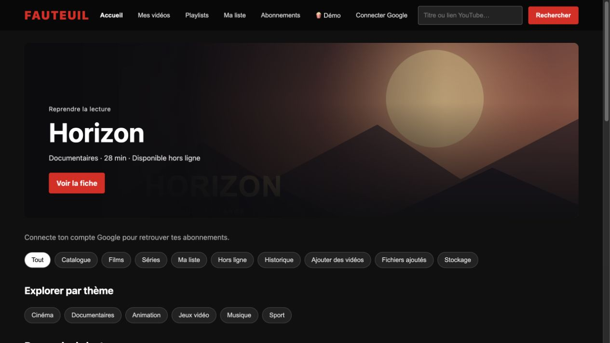

# Fauteuil — Médiathèque et lecteur vidéo pour macOS

Fauteuil rassemble **tes vidéos locales et tes playlists YouTube** dans une médiathèque personnelle sur Mac. Regarde tes vidéos dans l’application, reprends au dernier arrêt et garde une sélection pour le hors ligne.

[**Télécharger Fauteuil pour macOS**](https://github.com/NicoPFr/Fauteuil/releases/latest) · [Site de Fauteuil](https://nicopfr.github.io/Fauteuil/) · [Guide Google](docs/CONFIGURER_GOOGLE.md) · [English](docs/README.en.md)

> **macOS 15 ou ultérieur**, Apple Silicon et Intel. La lecture de fichiers locaux est disponible sans compte Google.

## Tes vidéos, de la bibliothèque à la lecture

| Tu veux… | Dans Fauteuil |
| --- | --- |
| **Organiser ta médiathèque** | Ajoute tes films et épisodes depuis leur emplacement. Fauteuil regroupe les séries par saison et ordonne les épisodes. |
| **Suivre une playlist YouTube** | Colle le lien d’une playlist publique. Configure Google si tu veux retrouver tes abonnements et tes playlists personnelles. Les Shorts et les vidéos de trois minutes ou moins sont écartés des résultats. |
| **Regarder tout de suite** | Quand le format le permet, la lecture commence pendant le téléchargement. En cas d’échec, Fauteuil prépare une copie temporaire. |
| **Reprendre ou enchaîner** | Reprends à la dernière position ou passe à l’épisode suivant depuis le lecteur intégré. |
| **Préparer une sélection hors ligne** | Conserve des titres ou une sélection. Fauteuil nettoie les copies temporaires après visionnage et laisse les fichiers personnels à leur emplacement. |

*Les deux captures utilisent une bibliothèque de démonstration.*

[Organiser ses films et séries sur Mac](https://nicopfr.github.io/Fauteuil/guides/organiser-videos-locales-sur-mac/) · [Regarder des playlists YouTube hors ligne sur Mac](https://nicopfr.github.io/Fauteuil/guides/playlists-youtube-hors-ligne-sur-mac/)

## Installation sur Mac

Le guide détaille le choix de la version macOS, la mise à jour et le premier test de lecture. [Installer et mettre à jour Fauteuil](https://nicopfr.github.io/Fauteuil/guides/installer-sur-mac/)

1. Télécharge **Fauteuil-macOS-universal.zip**, décompresse-le et ouvre **Fauteuil.app**. [Dernière release](https://github.com/NicoPFr/Fauteuil/releases/latest)
2. Choisis **Installer dans Applications**. Si une ancienne version est déjà installée, quitte-la et confirme la mise à jour à son emplacement. Fauteuil conserve tes vidéos, réglages et outils.
3. Choisis **Installer les outils** si l’application le propose. Fauteuil télécharge et vérifie ses dépendances automatiquement. Prévois une connexion à GitHub et environ **145 Mo** pour cette étape. [Détails des outils](docs/RUNTIME.md)
4. Ouvre **Mes vidéos → Ajouter des vidéos**. Tu peux aussi utiliser le dossier `~/Movies/Youtube/Movies`.

Sur **macOS 13 ou 14**, utilise la version 1.3.1 et installe ses dépendances manuellement. [Fauteuil 1.3.1](https://github.com/NicoPFr/Fauteuil/releases/tag/v1.3.1)

Apple n’a pas notarié la release. macOS peut demander une confirmation dans **Réglages Système → Confidentialité et sécurité** au premier lancement. [Documentation Apple](https://support.apple.com/fr-fr/102445)

## Questions fréquentes

**Faut-il un compte Google ?** Seulement pour synchroniser les abonnements et les playlists personnelles. La médiathèque locale et les playlists publiques ajoutées par lien sont utilisables sans compte Google. [Configuration Google](docs/CONFIGURER_GOOGLE.md)

**Où restent mes vidéos et mes réglages ?** Les fichiers ajoutés restent à leur emplacement. Fauteuil conserve les copies préparées, les métadonnées et les préférences sur le Mac. Les jetons durables sont stockés dans le Trousseau. [Architecture et stockage](docs/ARCHITECTURE.md)

**Tous les titres YouTube sont-ils disponibles ?** La disponibilité dépend des restrictions de la vidéo et des formats proposés par YouTube. Enregistre uniquement les contenus que tu es autorisé à télécharger.

[Configurer le compte YouTube et Google](https://nicopfr.github.io/Fauteuil/guides/connecter-youtube-a-fauteuil/) · [Retrouver les fichiers de Fauteuil sur Mac](https://nicopfr.github.io/Fauteuil/guides/stockage-et-confidentialite/) · [Comparer les versions macOS](https://nicopfr.github.io/Fauteuil/versions/)

## Code et contribution

L’interface utilise Swift, AppKit et WebKit. Les services locaux utilisent Python et SQLite. Avec les outils en ligne de commande Xcode et Python 3.11 ou ultérieur, `make build` produit `build/Fauteuil.app`. `make universal` produit le bundle pour les deux architectures, et `make test` utilise Node.js pour les tests Web. La commande `python3 scripts/demo.py` présente une bibliothèque fictive sur le port 8767.

[Architecture](docs/ARCHITECTURE.md) · [Contribuer](CONTRIBUTING.md) · [Kit de présentation](docs/press/README.md) · [Licence MIT](LICENSE)

*Fauteuil est un projet indépendant.*
