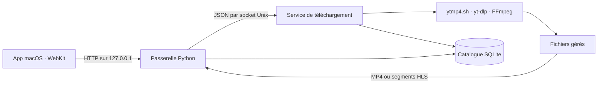

# Architecture de Fauteuil

Fauteuil est une application macOS locale. Elle lance une passerelle Python pour
l’interface et un processus distinct pour les téléchargements. Les deux
processus sont livrés dans le même bundle et utilisent une seule base SQLite.

## Du clic sur Lire à la vidéo

1. L’application Swift lance `python3 -m fauteuil` depuis les ressources du
   bundle. Elle vérifie `/api/health` avec un jeton propre au lancement avant de
   charger l’interface. La passerelle initialise le catalogue avant de lancer le
   processus de téléchargement.
2. L’interface appelle `POST /api/play`. Pour un fichier personnel, la
   passerelle répond directement. Pour un identifiant YouTube, le service de
   téléchargement cherche une copie locale, puis prépare le média si nécessaire.
3. En lecture progressive, le service attend que la playlist HLS couvre la
   position demandée et un tampon allant jusqu’à huit secondes. Il renvoie une
   URL de lecture sur la passerelle. Si l’interface doit reprendre après un
   échec HLS, elle peut redemander la source avec `wait_for_file` pour attendre
   le MP4. Un nettoyage des segments reste possible après le départ du lecteur.
4. WebKit lit le MP4 par plages d’octets sur `/api/media` ou les segments via
   `/api/stream`. Le socket Unix sert aux opérations de contrôle. Les octets des
   vidéos transitent directement de la passerelle vers WebKit.

## Où intervenir

| Besoin | Point d’entrée |
| --- | --- |
| Modifier la fenêtre ou le pont natif | [Cinema.swift](../app/macos/Cinema.swift) |
| Modifier le lecteur ou sa fiche | [Interface web](../app/web/) |
| Trouver les routes et les contrôles HTTP | [Passerelle](../app/fauteuil/http/) |
| Modifier le catalogue, la liste ou les fiches | [Catalogue](../app/fauteuil/catalogue/) |
| Gérer fichiers personnels, progression et espace disque | [Médias](../app/fauteuil/media/) |
| Modifier la recherche, les playlists ou la connexion Google | [YouTube](../app/fauteuil/youtube/) |
| Suivre un téléchargement ou sa suppression | [Service de téléchargement](../app/fauteuil/downloads/) |
| Modifier le schéma SQLite | [Initialisation de la base](../app/fauteuil/storage/database.py) |

Garde les opérations du catalogue et des médias utilisables depuis Python sans
objet HTTP. Les routes adaptent leurs résultats pour WebKit. Les routes qui
pilotent les téléchargements passent par le client du socket. Les structures de
suivi des tâches sont détenues par le processus de téléchargement. Le client
et le [serveur du socket](../app/fauteuil/downloads/worker.py) définissent
ensemble le contrat interne. L’interface utilise uniquement les routes de la
passerelle.

## Stockage et cycle de vie

| Emplacement | Contenu |
| --- | --- |
| `~/Movies/Youtube/Movies` | Vidéos personnelles découvertes automatiquement |
| Emplacement choisi à l’import | Fichier personnel référencé en base |
| `~/Movies/Youtube/Cinema/catalogue.sqlite3` | Catalogue, profils, positions, historique et registre des téléchargements |
| `~/Movies/Youtube/Cinema/À regarder` | Téléchargements gérés, temporaires ou marqués hors ligne |
| `~/Movies/Youtube/Cinema/jaquettes` | Jaquettes générées |
| Trousseau macOS | Secret client et jeton de renouvellement Google |

Le lecteur envoie ses positions successivement pour préserver l’ordre entre la
dernière position et l’événement de fin. En quittant Fauteuil, Swift laisse à
WebKit jusqu’à trois secondes pour vider cette file avant d’arrêter la
passerelle.

La fin d’une vidéo ou la fermeture à **moins de 30 secondes** de la fin peut
marquer la lecture comme terminée. Pour une vidéo en cours de préparation, le
service vérifie la durée connue côté téléchargement afin qu’une fin de tampon
ne soit pas confondue avec la fin du titre.

Pour une copie temporaire, la transaction enregistre à la fois la fin du
visionnage et la demande de suppression avec l’identifiant et le chemin du
fichier. Le service revérifie le chemin, la conservation hors ligne et les
tâches actives avant la suppression. Si le fichier est encore en préparation,
la demande est reprise après le téléchargement. Si le disque refuse la
suppression, la demande reste en base pour une nouvelle tentative, notamment au
prochain démarrage. Les vidéos personnelles et les copies gardées hors ligne
sont exclues de ce nettoyage automatique.

## Arrêt et diagnostic

La fermeture de la passerelle ferme aussi le tube de contrôle du service de
téléchargement. Le service arrête alors ses groupes de processus, y compris
les outils lancés pendant un téléchargement. Si le service devient
indisponible, la passerelle continue de servir le catalogue et les fichiers
personnels. Relancer Fauteuil redémarre les deux processus.

Pour une vérification du rendu indépendante de ta bibliothèque, lance
`python3 scripts/demo.py` et ouvre `http://127.0.0.1:8767/`. La démo sert des
données fictives. Pour vérifier les frontières entre les processus, la lecture
progressive et la suppression, lance `make test` à la racine. Les tests Python
utilisent des fichiers temporaires et des services de test sur la boucle
locale. Les tests JavaScript exercent le lecteur sans ouvrir l’application.

Le [guide de contribution](../CONTRIBUTING.md) indique les commandes de
compilation et les vérifications à joindre à une modification.
