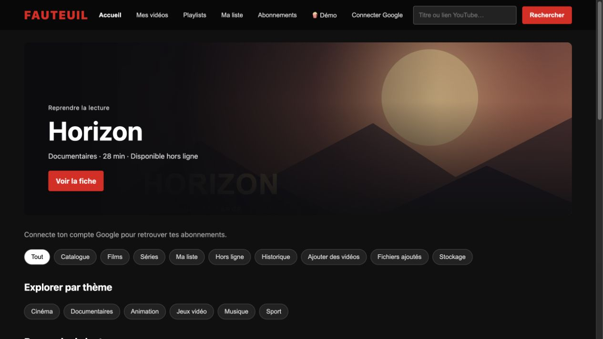

# Fauteuil

A personal video library for macOS. Browse local files and YouTube playlists, play videos inside the app, resume where you left off and keep selected titles available offline.

[Download Fauteuil](https://github.com/NicoPFr/Fauteuil/releases/latest) · [French README](../README.md)

- Index local video files in place and group episodes into seasons.
- Browse YouTube subscriptions, import ordered playlists and continue to the next episode.
- Start playback while supported videos download. Fauteuil falls back to a temporary local copy when progressive playback fails.
- Keep a selection offline or let Fauteuil clean up completed temporary downloads.

The universal build targets macOS 13+, Apple Silicon and Intel. GitHub release builds are ad hoc signed and are not notarized. Install the runtime dependencies with `brew install python ffmpeg yt-dlp deno`. To build locally, install Xcode Command Line Tools and run `make build`. The app interface is currently in French.

Local playback needs no account. YouTube subscriptions and personal playlists use a user-provided OAuth client. See the [Google setup guide in French](../app/CONFIGURER_GOOGLE.md). Download only content you have permission to save.

MIT licensed. Made with Swift, WebKit, Python and SQLite.
